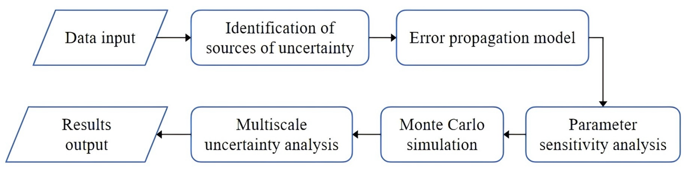

# Uncertainty Quantification for Spatial Data Attribute Updates with Application to Vegetation Cover



## Environment

The experiments were conducted on a Dell Workstation with NVIDIA Quadro P5000 GPU and Windows 10.

**Crucial packages:**
- Python 3.11.11
- CUDA 12.1
- PyTorch 2.1.0
- numpy 1.24.4
- scipy 1.10.0
- pyyaml 6.0
- tqdm 1.2.0
- rasterio 1.3.1
- geopandas 0.13.2
- libpysal 4.7
- esda 2.4
- SALib 1.5
- pandas 1.5

## Data Acquisition

- 250 m FVC product: [https://doi.org/10.11888/Terre.tpdc.300330]
- Sentinel-2 imagery: [https://dataspace.copernicus.eu/]

## Repository Structure

```
├─README.md
├─config_template.yaml
├─requirements.txt
├─src/
│├──relative_truth.py
│├──error_propagation.py
│├──bootstrap_corr.py
│├──sensitivity.py
│├──monte_carlo.py
│├──multiscale.py
│└──utils.py
├─examples/
│└──run_synthetic.py
```

## Quick Start
```
python examples/run_synthetic.py 
```
- The configs can be modified in config_template.yaml. 
- This exercises covariance-based propagation, contribution decomposition, multivariate-normal Monte Carlo sampling, and interval estimation on synthetic
inputs. The values used are synthetic and for demonstration only. They are not the experimental values of the study.

## Execution order
- relative_truth.py\
 ▼
- bootstrap_corr.py\
 ▼
- error_propagation.py\
 ▼
- sensitivity.py\
 ▼
- monte_carlo.py\
 ▼
- multiscale.py

## Reproducibility Notes
- The code reproduces the method, not the exact numerical results of the paper, because the trained weights, derived layers, and experimental parameter
values are not distributed.
- To apply the method to a new region or attribute, supply your own data and re-estimate all calibrated quantities (error contributions, correlations,
adjustment factors, and the scale-transition zone).

## Note
This repository contains some source code and data used in research projects. Meanwhile, the manuscript is still under review, and the complete code and model weights will be made public once the manuscript is published and the overall research is completed.